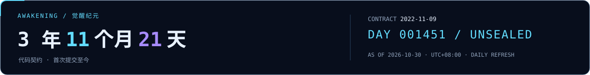

<a href="https://github.com/lionelGallagher?tab=repositories">
  <picture>
    <source media="(max-width: 600px)" srcset="./images/domain-awakening-mobile.png" />
    
  </picture>
</a>

  
  
  
  

<a href="./data/profile.json">
  <picture>
    <source media="(max-width: 600px)" srcset="./images/experience-mobile.svg" />
    
  </picture>
</a>

   &nbsp;
   &nbsp;
   &nbsp;
   &nbsp;
   &nbsp;
   &nbsp;
   &nbsp;
   &nbsp;
   &nbsp;
  

 

  
  

<picture>
  <source media="(prefers-color-scheme: dark)" srcset="https://raw.githubusercontent.com/lionelGallagher/lionelGallagher/output/github-contribution-grid-snake-dark.svg" />
  
</picture>

