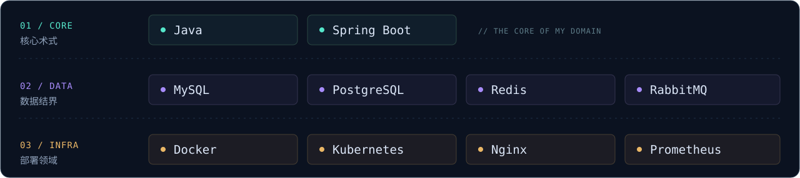
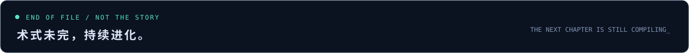

  <picture>
    <source media="(max-width: 600px)" srcset="./images/terminal-header-mobile.svg" />
    
  </picture>

  <a href="https://blog.csdn.net/m0_55928120"><strong>技术手记 · CSDN</strong></a>
  &nbsp; / &nbsp;
  <a href="#03--missions-任务记录"><strong>任务记录 · Projects</strong></a>
  &nbsp; / &nbsp;
  <a href="https://github.com/lionelGallagher?tab=repositories"><strong>全部仓库 · Repositories</strong></a>

### `01 / DOSSIER` 术式档案

> **「 将混沌编译为秩序，将想法部署到现实。 」**

我是 **lionel**，一名热爱后端、热爱技术的开发者。主修 Java 与 Spring，也喜欢在开源世界里发现新工具、拆解新问题。

<a href="./data/profile.json">
  <picture>
    <source media="(max-width: 600px)" srcset="./images/experience-mobile.svg" />
    
  </picture>
</a>

修炼起点：首次公开提交 · 每日按上海时间刷新 · 点击年限卡片可查看源记录。

### `02 / ARSENAL` 术式武装库

<picture>
  <source media="(max-width: 600px)" srcset="./images/arsenal-mobile.svg" />
  
</picture>

### `03 / MISSIONS` 任务记录

| `MAIN QUEST` 原创任务 | `SIDE QUEST` 开源探索 |
| :--- | :--- |
| **[lionel-emos-system](https://github.com/lionelGallagher/lionel-emos-system)** | **[mcpm.sh](https://github.com/lionelGallagher/mcpm.sh)** |
| Java 后端工程，记录从想法到代码的实现与迭代。 | MCP 服务管理工具的 Fork，用来探索 AI 工具与开发工作流。 |
| `Java` · `Backend` | `MCP` · `CLI` · `Fork` |

### `04 / BATTLE LOG` 战绩记录

  
  &nbsp;
  

<strong>展开领域 · 贡献轨迹</strong>

 
<picture>
  <source media="(prefers-color-scheme: dark)" srcset="https://raw.githubusercontent.com/lionelGallagher/lionelGallagher/output/github-contribution-grid-snake-dark.svg" />
  <source media="(prefers-color-scheme: light)" srcset="https://raw.githubusercontent.com/lionelGallagher/lionelGallagher/output/github-contribution-grid-snake.svg" />
  
</picture>

 

<picture>
  <source media="(max-width: 600px)" srcset="./images/terminal-footer-mobile.svg" />
  
</picture>
